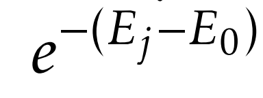

# Excited-state-wave-functions-using-quantum-Monte-Carlo

Quantum Monte Carlo methods can be extended to compute the excited state wave functions
using a Gram–Schmidt procedure to insure that each excited state is orthogonal to all lower
lying states (see Roy et al.). A quantum Monte Carlo method is used to compute the ground state
wave function. A trial wave function for the first exited state is then selected and the ground
state component is subtracted from the trial wave function. This subtraction is repeated after
every iteration of the Monte Carlo algorithm. Because excited states decay with a time constant

e^−(Ej−E0), 
the lowest remaining excited state dominates the remaining wave function. After the
first excited state is obtained, the second excited state is computed by subtracting both known
states from the trial wave function. This process is repeated to obtain additional wave functions.
Implement this procedure to find the first few excited state wave functions for the onedimensional harmonic oscillator. Then consider the one-dimensional double-well oscillator

Implement this procedure to find the first few excited state wave functions for the onedimensional harmonic oscillator. Then consider the one-dimensional double-well oscillator

with k = 40, a3 = 1, and a4 = 1